# Ascent 🏫 - Website interface for kindergartens and primary schools

## 📋 Project Overview

Ascent is a modern web project utilizing Tailwind CSS for styling and incorporating advanced frontend libraries to create an engaging user experience, Website interface for kindergartens and primary schools, introducing curriculum, services and educational activities and connecting with parents

## 🚀 Features

- Responsive design with Tailwind CSS
- Smooth animations using Animate.css
- Interactive components with Swiper
- Scroll animations with WOW.js

## 🛠 Technologies Used

- JavaScript
- Tailwind CSS v3.4.14
- Animate.css v4.1.1
- Swiper v11.1.14
- WOW.js v1.1.3

## 📦 Prerequisites

- Node.js (recommended version 16+ or latest LTS)
- npm (Node Package Manager)

## 🔧 Installation

1. Clone the repository:

```bash
git clone https://github.com/vuth9808/ascent2
cd ascent2
```

2. Install dependencies:

```bash
npm install
```

3. Click index.html

4. Open with Live Server # or Open In Default Browser

## 🖼️ Demo Images

<div align="center">
    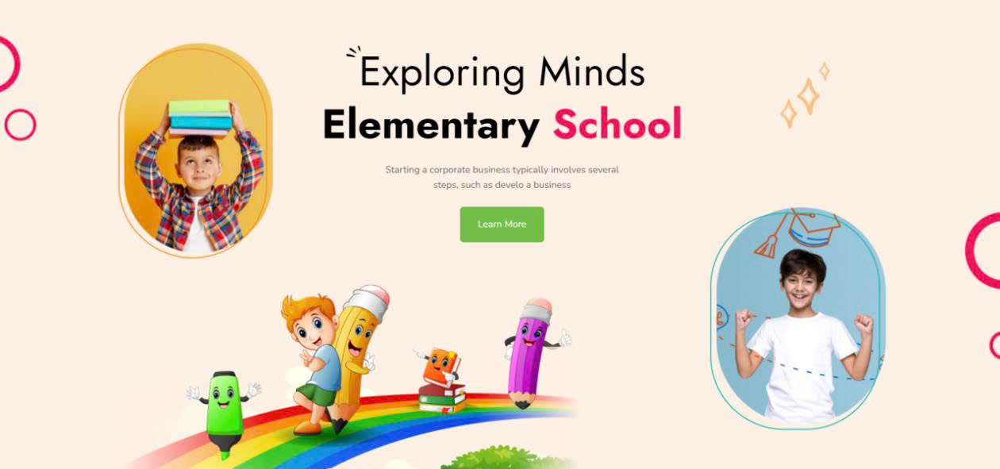
    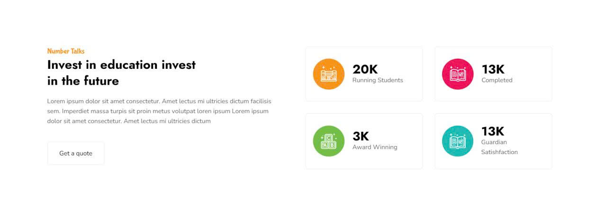
    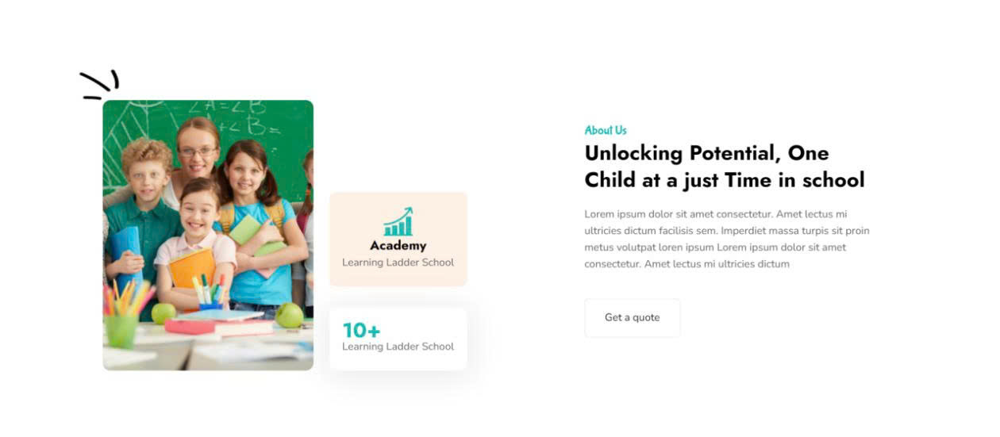
    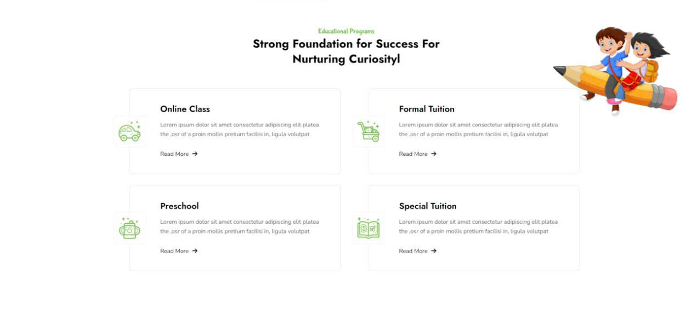
    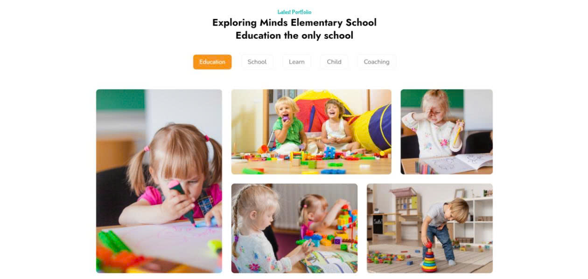
    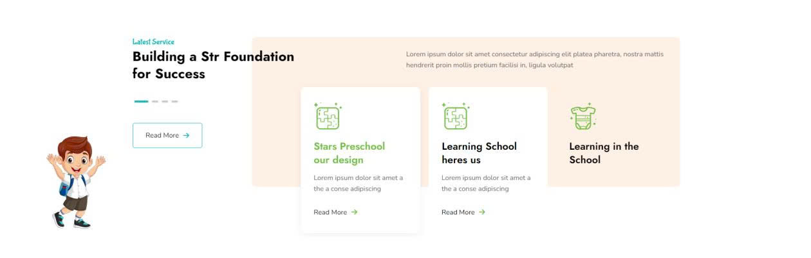
    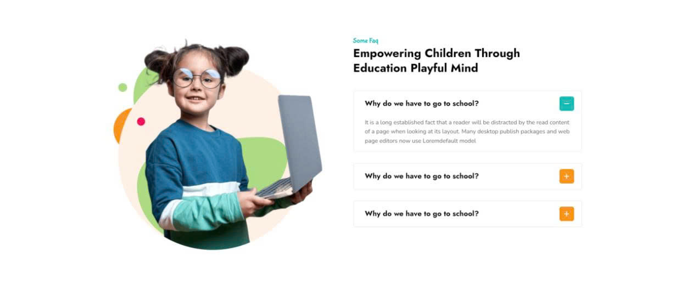
    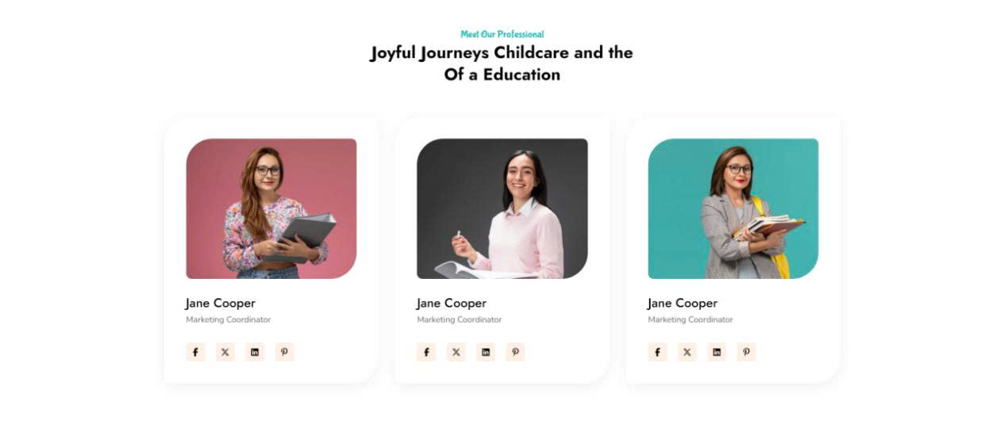
    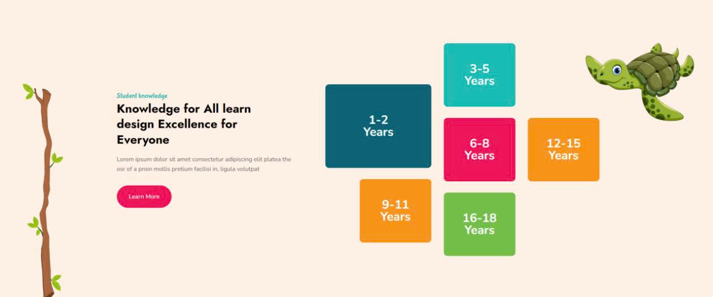
    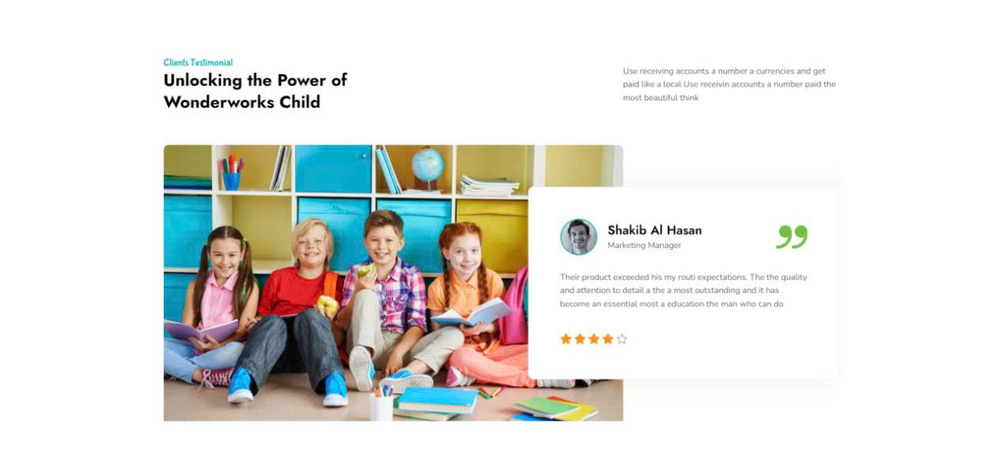
    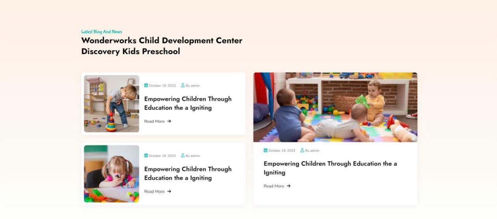
    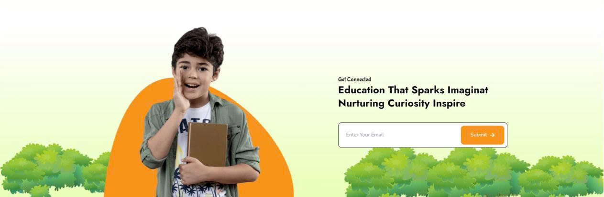
    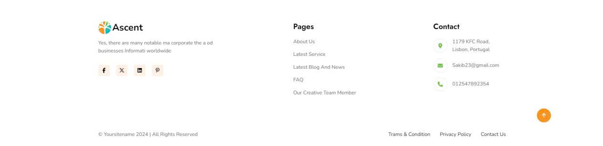
</div>

## 📄 License

Distributed under the MIT License. See `LICENSE` for more information.

## ✉️ Contact

TO HOANG VU - tohoangvu161225@gmail.com
